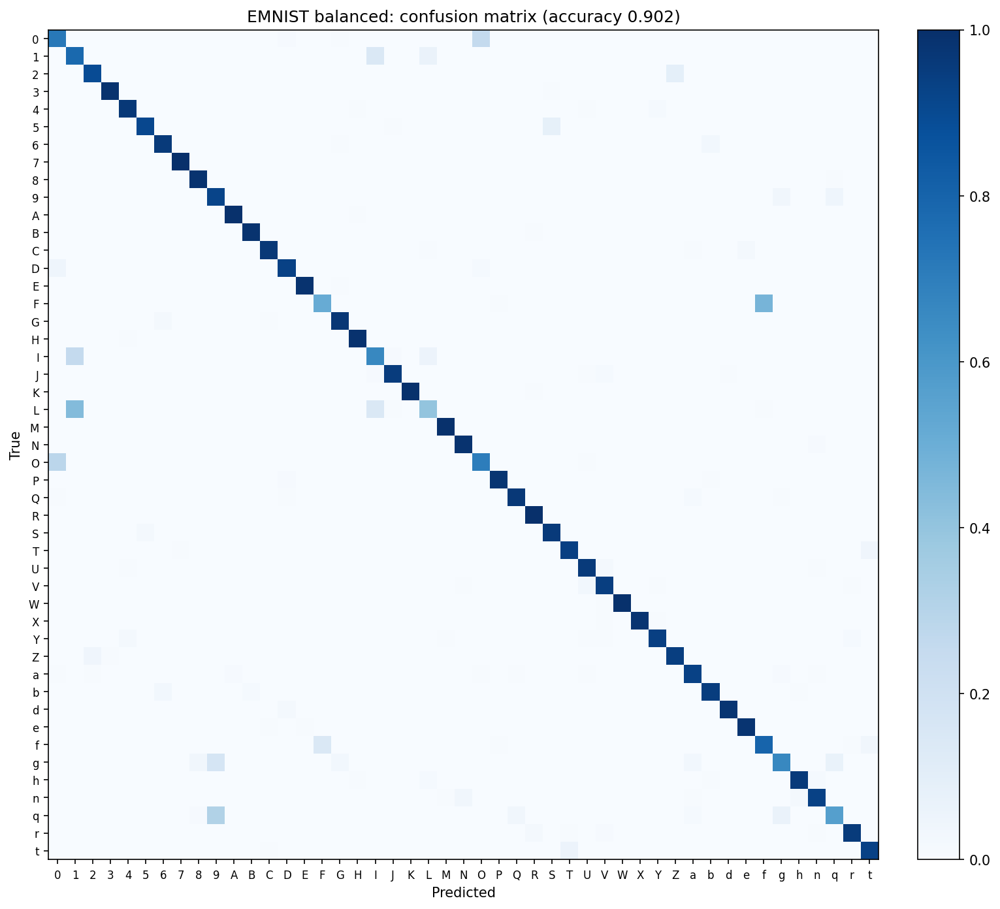
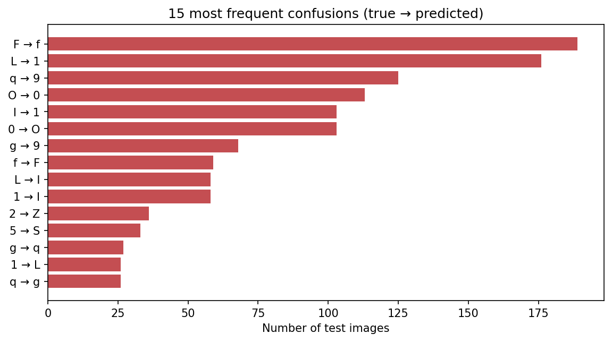
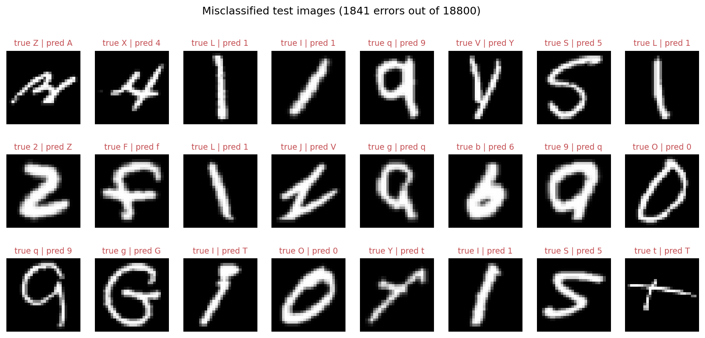
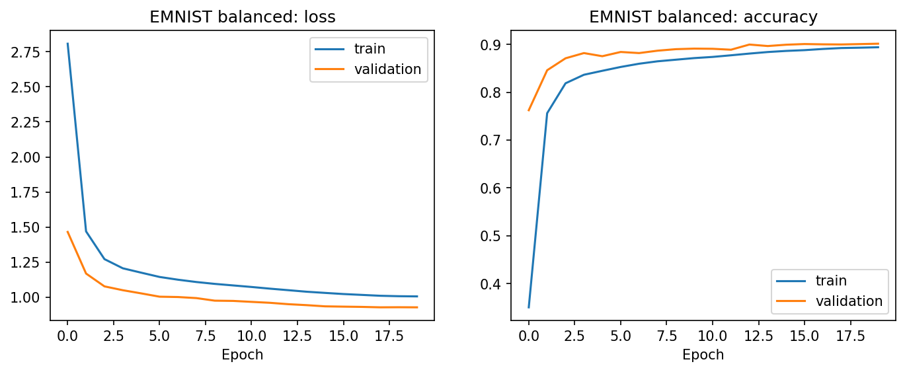
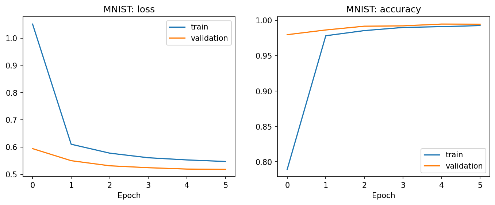
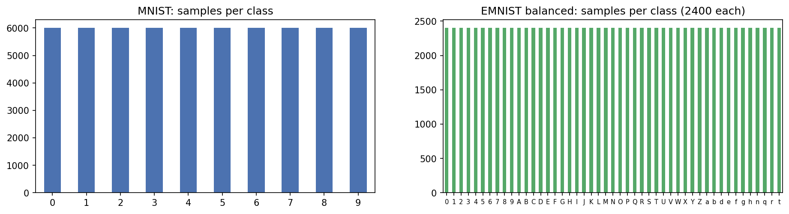
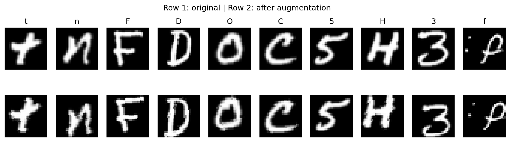

# CharVision AI: Handwritten Character Recognition

CharVision AI is an interactive handwritten-character recognition project powered by a convolutional neural network (CNN). A FastAPI backend loads the trained model for inference, while a responsive React interface provides a live drawing canvas and visualizations of the model's evaluation results.

**Features**

- Draw a character with a mouse or touch screen and get live predictions.
- See the top three predictions and their probabilities.
- Inspect the normalized 28 × 28 image that the model receives.
- Filter results to digits, letters, or both.
- Experiment with word mode and character segmentation.
- Explore model performance, per-class results, and common confusions.
- Review recent recognitions in local history and export them as CSV.

## Objective and datasets

The project compares a digit-only baseline trained on [MNIST](http://yann.lecun.com/exdb/mnist/) with a 47-class recognizer trained on [EMNIST Balanced](https://www.nist.gov/itl/products-and-services/emnist-dataset). EMNIST Balanced contains digits 0–9, uppercase A–Z, and the lowercase classes `a`, `b`, `d`, `e`, `f`, `g`, `h`, `n`, `q`, `r`, and `t`.

The goal is to make the trained models accessible through an interactive drawing interface and to report their held-out test-set performance. The CNN recognizes one character at a time; the word mode is an experimental segmentation aid, not a handwriting-recognition model for connected text.

## Methodology

### Data preparation

- The training pipeline reads the MNIST and EMNIST CSV image data and the corresponding class mappings.
- EMNIST images are stored transposed relative to the expected orientation; training data is transposed before use.
- Pixel normalization uses the mean and standard deviation computed from the training split.
- Training augmentation uses random affine transforms.

### Model and training

The classifier is a compact CNN with three convolutional blocks. Each block contains two convolution and batch-normalization layers with ReLU activations, followed by max pooling and dropout. A dense classifier maps the final features to the class scores.

Training was performed in Google Colab using AdamW and OneCycleLR with label smoothing of 0.1. The training data was divided into 90% training and 10% validation sets. The checkpoint with the best validation result was selected; the test sets were held out for final evaluation and were not used for checkpoint selection.

### Drawing inference

At inference, the recognizer detects the ink, crops the character, resizes it to fit a 22-pixel longest side, and centers it by center of mass on a 28 × 28 canvas. The resize target was selected during validation. This preprocessing lets the model handle dark ink on a light background, light ink on a dark background, and transparent drawing backgrounds.

## Results

The figures below are read from [`results/final_metrics.json`](results/final_metrics.json). Parameters are the number of learned model parameters.

| Dataset | Classes | Test accuracy | Macro F1 | Parameters |
|---|---:|---:|---:|---:|
| MNIST | 10 | 99.62% | 99.62% | 585,130 |
| EMNIST Balanced | 47 | 90.21% | 90.05% | 594,639 |

### EMNIST Balanced class F1

The five highest and eight lowest class F1 scores, sorted from the supplied per-class report:

| Highest F1 | F1 | Lowest F1 | F1 |
|---|---:|---|---:|
| K | 0.9962 | L | 0.5170 |
| W | 0.9937 | F | 0.6154 |
| 3 | 0.9925 | 1 | 0.6297 |
| M | 0.9900 | q | 0.6637 |
| E | 0.9900 | I | 0.6726 |
|  |  | 0 | 0.6990 |
|  |  | f | 0.7025 |
|  |  | O | 0.7078 |

### Frequent confusions

These are the eight most frequent directed confusions in [`results/top_confusions_emnist.csv`](results/top_confusions_emnist.csv). The percentage is the share of the true class predicted as the listed alternative.

| True class | Predicted as | Count | Of true class |
|---|---|---:|---:|
| F | f | 189 | 47.2% |
| L | 1 | 176 | 44.0% |
| q | 9 | 125 | 31.2% |
| O | 0 | 113 | 28.2% |
| I | 1 | 103 | 25.8% |
| 0 | O | 103 | 25.8% |
| g | 9 | 68 | 17.0% |
| f | F | 59 | 14.8% |

These confusions reflect the visual similarity of handwritten shapes. EMNIST also merges uppercase and lowercase for look-alike letters such as C/c, O/o, S/s, W/w, X/x, Z/z, and K/k; the model returns the available uppercase class for these merged forms. Other common ambiguities include `I`/`1` and `F`/`f`.

### Evaluation figures















## Project structure

```text
.
├── api.py
├── char_recognizer.py
├── test_recognizer.py
├── requirements.txt
├── models/
│   ├── cnn_emnist.pt
│   ├── cnn_mnist.pt
│   └── model_info.json
├── results/
│   ├── final_metrics.json
│   ├── classification_report_emnist.csv
│   ├── top_confusions_emnist.csv
│   └── evaluation figures and supplementary reports
├── datasets/
│   └── README.md
├── docs/
│   └── screenshots/
├── frontend/
│   ├── src/
│   ├── package.json
│   └── vite.config.ts
├── LICENSE
└── README.md
```

The model checkpoints and evaluation assets are included in this repository. Dataset files are not included; see [`datasets/README.md`](datasets/README.md).

## Installation and run

### Windows PowerShell

From the project root, create and activate a virtual environment and install the Python dependencies:

```powershell
python -m venv .venv
.\.venv\Scripts\Activate.ps1
python -m pip install --upgrade pip
python -m pip install -r requirements.txt
```

If you are on a CPU-only Windows machine, install the CPU wheel of PyTorch explicitly before installing the remaining requirements:

```powershell
python -m pip install torch --index-url https://download.pytorch.org/whl/cpu
python -m pip install -r requirements.txt
```

In the first PowerShell terminal, start the API from the project root:

```powershell
uvicorn api:app --reload --port 8010
```

In a second terminal, start the frontend:

```powershell
cd frontend
npm install
npm run dev
```

Open the app at [http://localhost:5173](http://localhost:5173) and the interactive API documentation at [http://localhost:8010/docs](http://localhost:8010/docs). The Vite development server proxies API and result-image requests to port 8010.

### macOS and Linux

Create and activate a virtual environment with `python3 -m venv .venv` and `source .venv/bin/activate`, then run `python -m pip install -r requirements.txt`. Start the API with `uvicorn api:app --reload --port 8010`; in another terminal, enter `frontend/`, run `npm install` and `npm run dev`, then open the same URLs as above. Install the appropriate PyTorch wheel for your platform if the default `torch` installation is unsuitable.

### Quick test without the interface

With the Python environment and model files installed, run:

```powershell
python test_recognizer.py
```

The script predicts a synthetic character and writes `processed_preview.png` in the project root. To test an image file instead, pass its path, for example `python test_recognizer.py path\to\image.png`.

## Retraining

The training notebook is not included in this repository. The models were trained in Google Colab using the data preparation and training pipeline described above. Download the EMNIST and MNIST CSV data and mapping files and put them in the folders described in [`datasets/README.md`](datasets/README.md). The pipeline must write `models/cnn_emnist.pt`; the inference loader expects a checkpoint containing the keys `state_dict`, `classes`, `mean`, `std`, and `num_classes`. Keep the test split untouched for final evaluation. The supplied `models/` and `results/` should only be replaced when a retraining run has produced and validated matching checkpoints and evaluation files.

## Limitations

- EMNIST Balanced test accuracy is 90.21%; performance varies by class, with the largest errors on visually ambiguous characters.
- EMNIST merges uppercase and lowercase forms for some look-alike letters. A lowercase display option changes presentation only; it does not add a separately trained class.
- Confusions include `F`/`f`, `L`/`1`, `q`/`9`, `g`/`9`, `O`/`0`, and `I`/`1`.
- Word mode segments separate character components and is experimental. It requires characters not to touch and does not reliably handle cursive handwriting or connected words.
- Mouse or touch drawings can differ from the handwriting styles represented in the training data.

## Future work

- Sequence recognition for words and sentences using a CRNN with CTC loss.
- TrOCR for handwritten text lines.
- Camera input.
- Fine-tuning with examples drawn in the app.
- ONNX model export.

## Screenshots

Add screenshots of the running app at these paths:


## License and disclaimer

This project is distributed under the [MIT License](LICENSE).

Educational project. The predictions are model estimates, not guaranteed transcriptions. Dataset terms and attribution requirements remain applicable to the underlying data.
